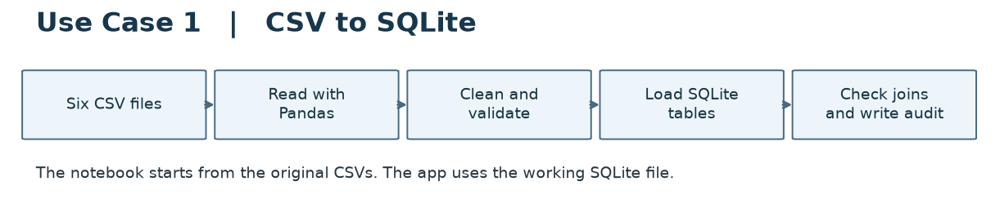
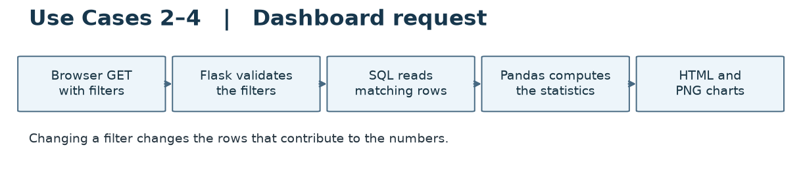
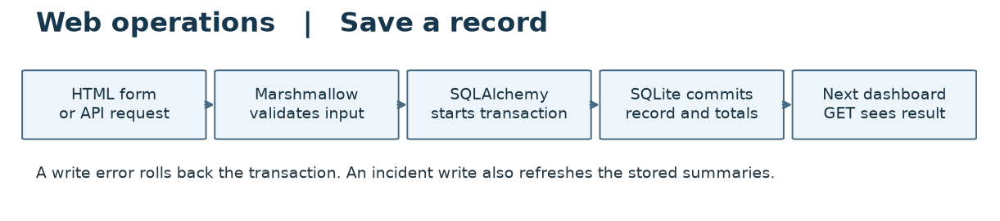

# Chicago Crime Explorer viva walkthrough

## Start with the story

“I built a Flask app around a sample of Chicago crime records. I cleaned one incident CSV and five lookup CSVs, then stored them in SQLite. The dashboard reads that database and shows trends, offences, arrests and community patterns. I also added forms and an API for editing incidents and communities. When I save an incident, I can reopen the dashboard and see the updated totals.”

## 1. How the data gets into SQLite

Start in [use_case_1.py](../chicago-crime-explorer/use_case_1.py). The entry point is `run_pipeline()`, which receives the dataset folder and destination database path and returns the import audit.

| Function | What it receives | What it returns or does |
|---|---|---|
| `read_source()` | One CSV path, plus lists for repairs and rejections | A Pandas DataFrame. It trims text and records source row numbers. |
| `prepare_dimensions()` | The loaded CSV tables | A dictionary of lookup DataFrames with consistent keys. |
| `convert_incident_fields()` | The raw incident DataFrame | A copy with numeric fields, parsed dates and normalized flags and codes. |
| `valid_incidents()` | Converted rows, original rows and audit lists | Rows with valid required fields and unique IDs and case numbers. It records rejected rows and their reasons. |
| `clean_crimes()` | Incident rows and lookup tables | Clean incident rows with year, month, weekday and hour where available. It updates the audit. |
| `write_database()` | Prepared DataFrames, rejected rows, audit and destination path | Writes tables, views and summaries, then checks foreign keys and join totals. |

**Pandas** gives me a table in memory called a DataFrame. A column is a Series. I read codes as text because values like `0820` can lose their leading zero when treated as numbers. I repaired two missing closing quotes in the final coordinate fields and kept the original CSVs. **Pandera** checks batches of rows for required fields such as ID, case number and date. **NumPy** measures missingness by averaging a mask where each missing value is marked 1 and each present value is marked 0.

**SQLite** stores the cleaned records in a file. A primary key uniquely identifies a row. A foreign key references a lookup key. For example, an incident's `iucr_code` points to `iucr.iucr_code`. The enriched view uses a LEFT JOIN to add readable labels while keeping incidents with missing lookup values. I check that the join still gives 498 rows. For wards, I keep one key per ward and store the office records separately. Multiple offices for the same ward could otherwise multiply rows in a join. [Database schema](../chicago-crime-explorer/sql/schema.sql) · [SQL views](../chicago-crime-explorer/sql/views.sql)

## 2. How the dashboard gets its numbers

1. The browser sends a GET request such as `/?year=2016&category=THEFT`. Flask matches the URL to `index()`. Marshmallow validates the filter fields.
2. `load_selection(db_path, filters)` passes the values to SQL as bound parameters and reads the selected rows with Pandas. Its return value contains the rows, calculated statistics, filters, import audit and full count.
3. `summarize()` receives those rows and the community lookup. It returns a dictionary of totals, tables and descriptive statistics. For a full selection it can use the yearly and category results read from SQL views.
4. Jinja fills the HTML template with values and chart URLs. The browser requests the PNGs separately. `chart_png()` receives the chart name, rows and statistics and returns PNG bytes in memory. [Flask routes](../chicago-crime-explorer/app.py) · [SQL reads and chart responses](../chicago-crime-explorer/use_case_4.py)

| Concept | How I explain it |
|---|---|
| Grouping | I group rows by year or offence, then count each group. |
| Offence share | I divide the offence count by all selected incidents. Theft is 105 ÷ 498, or 21.08% in the fresh import. |
| Arrest percentage | I divide recorded arrests by rows with a known arrest flag. The fresh import has 124 ÷ 498, or 24.90%. |
| Heatmap | A cross-tab counts each month and weekday combination. Seaborn colours the cells so the larger counts are easy to spot. |
| Per 10,000 residents | I divide a community's sample count by its supplied population and multiply by 10,000. This compares counts relative to population within this sample. |
| Outliers | IQR is Q3 minus Q1. An upper fence of 19.5 flags Austin (34), Humboldt Park (20) and Near North Side (20) in the baseline. |
| Correlation | Pearson’s r describes linear association. The strongest absolute association is about −0.31 between year and weekday. The concentration on a few dates matters when interpreting it. |
| Hourly analysis | The incident dates have zero recorded times. I leave the hour missing and show insufficient data. A date parsed as midnight supplies a storage value, and the original incident hour is still unknown. |
| View and summary table | A SQL view saves a query. A summary table stores the query’s results. The app refreshes the stored summaries after an incident write. |
| Chart rendering | Matplotlib creates the figure and Seaborn draws heatmaps and box plots. A threading `RLock` serializes figure creation and saving within the Flask process. |

The sample includes 490 of its 498 incidents in 2016. Two dates account for 443 records. Use those figures to explain what the annual chart actually measures. [Exploration code](../chicago-crime-explorer/use_case_2.py) · [Statistical analysis](../chicago-crime-explorer/use_case_3.py)

## 3. What the operations part does

“When I save the form, Flask receives the fields. Marshmallow checks them and converts them into Python values. The API and the HTML form both use `change()` to call the database code. SQLAlchemy commits a successful write. The next dashboard request reads the updated database.”

| Method | Example | Meaning |
|---|---|---|
| GET | `GET /api/communities/901` | Read one community. |
| POST | `POST /api/communities` | Create a record. A successful response is 201. |
| PUT | `PUT /api/communities/901` | Replace its editable fields. Supply the name and population. |
| PATCH | `PATCH /api/communities/901` | Send only the changes, such as `{"population": 20000}`. |
| DELETE | `DELETE /api/communities/901` | Delete it if no incident references it. Success is 204. A linked community returns 409. |

The HTML forms use POST for saves and confirmed deletes. A successful form submission redirects to a GET page, so a browser refresh can reload the list. A token ties the write to the browser session. The API offers the separate HTTP methods above, and Flask-Smorest uses the Marshmallow schemas to generate the OpenAPI definition shown in Swagger. [Forms](../chicago-crime-explorer/app.py) · [Validation](../chicago-crime-explorer/schemas.py) · [API](../chicago-crime-explorer/api.py)

**SQLAlchemy Core** gives Python a way to build queries and manage database connections. A transaction groups the record write and, for an incident, the yearly and category summary refresh. If a write fails, both changes roll back together. **Search** looks for text in supported columns. **Filtering** narrows the rows, **sorting** orders them, and **pagination** returns one page using LIMIT and OFFSET. [Database operations](../chicago-crime-explorer/database.py)

## Five-minute practice run

1. Start the app and open the dashboard at `http://127.0.0.1:5057`. Read the totals displayed by your copy of the database.
2. Open [the notebook](../chicago-crime-explorer/chicago_crime_analysis.ipynb) and show the first ten rows. Explain the two quote repairs and why `0820` is a text code.
3. On the dashboard, filter by year and offence. Open the matching records and explain where the count came from. Show the hourly data limitation.
4. Under **Communities**, create a fictional demo entry using an unused code. Search for it, change its population, then delete it. Repeat the HTTP-method explanation using `/api/docs/`.
5. If asked what changes a crime chart, explain the report demo. Adding an incident took the baseline from 498 to 499. Changing its arrest flag raised arrests from 124 to 125. Deleting the incident restored the original totals.

### Quick answers to practise aloud

- **What is ETL?** I extract rows from CSV, transform them into consistent records, and load them into SQLite.
- **Why two kinds of validation?** Pandera checks rows during CSV import. Marshmallow checks values coming from the browser or API.
- **Why does a new community leave the crime total alone?** It adds a lookup row. An incident needs to reference it before it contributes to that community’s crime count.
- **Does the app rewrite the CSV after an edit?** The form writes to SQLite. The notebook imports the original CSVs and reproduces the baseline.
- **Is the project asynchronous?** The Flask routes and database calls are synchronous. The chart lock coordinates concurrent chart rendering within the process.
- **What happens if I restart Flask?** It reopens the SQLite file, so committed edits are still there. The CSV import is a separate step.
